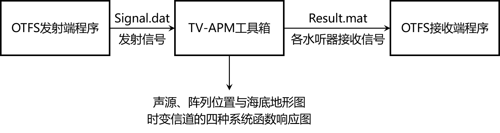
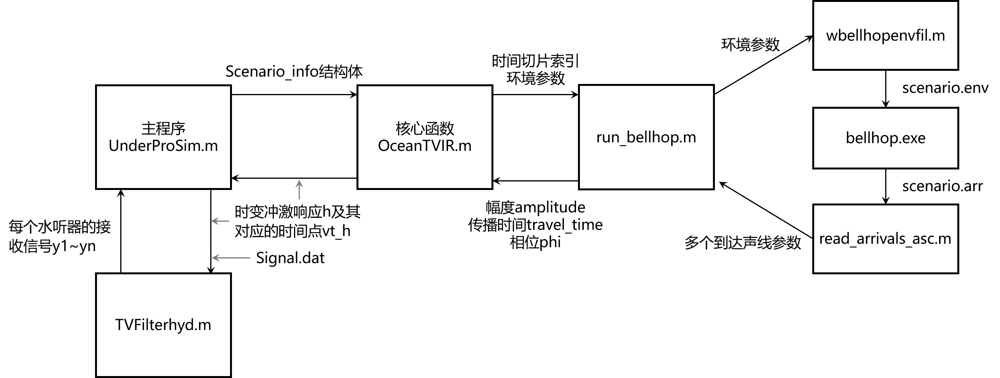

  # 程序介绍

&emsp;Hello，这是我的本科毕业设计的完整MATLAB程序，主要关于时变水声传播模型和OTFS水声信道估计与迭代均衡技术，该项目是为了水下移动网络节点间的水声通信与组网设计的。欢迎用户修复Bug、扩展功能，并在开源社区分享成果。

&emsp;水声信道有限的带宽、严重的多径扩展与显著的多普勒频移是制约高速可靠通信的关键因素。与OFDM系统相比，OTFS系统使时变信道在时延-多普勒域中变为准静态稀疏信道，防止子载波正交性被破坏。

&emsp;Bellhop水声工具箱功能强大，已经被广泛应用于各类水声原理和算法验证。
其中对于单载波静态水声通信仿真，利用Bellhop可以生成完整多径信道冲激响应，在接收端进行信道估计与均衡仿真。
&emsp;但是Bellhop只能针对静态场景进行水下声学仿真，因此需要基于Bellhop，在其上层开发框架，将动态场景采样为多个时间切片，分别调用Bellhop进行仿真。
&emsp;闫正强等人[1]使用Bellhop水声工具箱进行OFDM水声通信系统仿真，验证了Bellhop应用于多载波场景的可行性，文献第三章使用了OFDM系统的中心频率作为Bellhop的声波频率参数。

[1]闫正强.基于压缩感知的水声OFDM系统信道估计方法研究[D].青岛科技大学,2020.DOI:10.27264/d.cnki.gqdhc.2020.000591.

  # 程序架构

图一：程序总体架构图

图二：TV-APM主要文件关系图

  # 安装Bellhop

  # 初次运行

